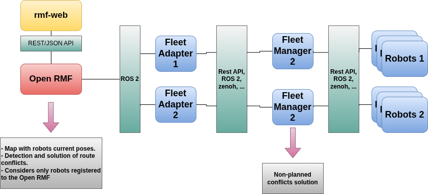

# Using multiple robots in Open-RMF

The Open-RMF supports the use of heterogeneous fleets of robots. Thus, it allows to use multiple robots of the same or different types. This document describes how to set up and use multiple robots in Open-RMF.

To use multiple robots in Open-RMF, we need to make the Open-RMF communicate with each robot individually. This is done through the use of the fleet adapters and fleet managers. The Open-RMF communicates with the fleet adapters, which in turn communicate with the fleet manager by using a Robot/Fleet API. See the diagram below:



The usual data flowing between the Open-RMF and the fleet manager through the fleet adapter are:
- Open-RMF sends navigate requests to the fleet adapter for each robot.
- The fleet adapter sends the navigate requests to the fleet manager through the API.
- The fleet manager commands the robots to navigate to the requested locations.
- The fleet manager gets the state of the robots and their sensors.
- The fleet manager sends the state of the robots to the fleet adapter through the API.
- The fleet adapter sends the state of the robots to the Open-RMF

## Open-RMF Layers

### Fleet Adapters

> This readme assumes the use of the [Open-RMF fleet adapter template](https://github.com/open-rmf/fleet_adapter_template/blob/main/fleet_adapter_template/fleet_adapter_template/fleet_adapter.py) with adaptions from the [Open-RMF demos ROS 2 Jazzy fleet adapter](https://github.com/open-rmf/rmf_demos/blob/jazzy/rmf_demos_fleet_adapter/rmf_demos_fleet_adapter/fleet_adapter.py). It is focused on the Python implementation of a fleet adapter.

The fleet adapter is responsible for loading the config YAML files of the robot fleet and adding the robots of that fleet to the Open-RMF. It will add all the robots listed under the `robots` section of the config YAML file. Here follows an example of a robot fleet config YAML file obtained from the [open_rmf_fleet_adapter for the ROS 2 Jazzy](https://github.com/open-rmf/rmf_demos/blob/jazzy/rmf_demos/config/office/tinyRobot_config.yaml):

```yaml
# FLEET CONFIG =================================================================
# RMF Fleet parameters

rmf_fleet:
  name: "tinyRobot"
  limits:
    linear: [0.5, 0.75] # velocity, acceleration
    angular: [0.6, 2.0] # velocity, acceleration
  profile: # Robot profile is modelled as a circle
    footprint: 0.3 # radius in m
    vicinity: 0.5 # radius in m
  reversible: True # whether robots in this fleet can reverse
  battery_system:
    voltage: 12.0 # V
    capacity: 24.0 # Ahr
    charging_current: 5.0 # A
  mechanical_system:
    mass: 20.0 # kg
    moment_of_inertia: 10.0 #kgm^2
    friction_coefficient: 0.22
  ambient_system:
    power: 20.0 # W
  tool_system:
    power: 0.0 # W
  recharge_threshold: 0.10 # Battery level below which robots in this fleet will not operate
  recharge_soc: 1.0 # Battery level to which robots in this fleet should be charged up to during recharging tasks
  publish_fleet_state: 10.0 # Publish frequency for fleet state, ensure that it is same as robot_state_update_frequency
  account_for_battery_drain: True
  task_capabilities: # Specify the types of RMF Tasks that robots in this fleet are capable of performing
    loop: True
    delivery: True
  actions: ["teleop"] # List of supported actions for robots in this fleet
  finishing_request: "park" # [park, charge, nothing]
  responsive_wait: True # Should responsive wait be on/off for the whole fleet by default? False if not specified.
  reassign_task_interval: 120 # seconds, specify how often a task reassignment should be triggered in the fleet
  robots:
    tinyRobot1:
        charger: "tinyRobot1_charger"
        responsive_wait: False # Should responsive wait be on/off for this specific robot? Overrides the fleet-wide setting.
    tinyRobot2:
        charger: "tinyRobot2_charger"
        # No mention of responsive_wait means the fleet-wide setting will be used

fleet_manager:
  ip: "127.0.0.1"
  port: 22011
  user: "some_user"
  password: "some_password"
```

In the config above two robots are added to the fleet: `tinyRobot1` and `tinyRobot2`. Each robot can have its own specific parameters, such as the charger location and finishing request.

If a different type of robot is to be used, a different config YAML file should be created for that robot fleet, specifying the parameters for that type of robot.

> Note: The same fleet adapter can be used for different fleets of robots. It is only necessary to call it separately with different config YAML files for each fleet.

A full implemented fleet adapter can be found in the [open_rmf_fleet_adapter for the ROS 2 Jazzy](https://github.com/open-rmf/rmf_demos/blob/jazzy/rmf_demos_fleet_adapter/rmf_demos_fleet_adapter/fleet_adapter.py).

In the OpenRMF framework, the fleet adapter acts as a bridge between the robots and the core system. It updates the traffic schedule, responds to tasks, and provides the necessary conditions for optimal task allocation across all involved fleets.

In addition to the .yaml file described above, the fleet adapter requires a navigation graph file. This allows RMF to interpret the robots' operational environment and understand how they navigate the map. This file can be created intuitively using the [RMF Traffic Editor](https://github.com/open-rmf/rmf_traffic_editor) and [building map generator](https://github.com/open-rmf/rmf_ros2/blob/main/rmf_fleet_adapter/src/rmf_fleet_adapter/agv/parse_graph.cpp) tools.

The two main parts implemented inside the `fleet_adapter.py` file are the *main* function and the *RobotAdapter* class, which are discussed below.

- **main function**
The `main(argv=sys.argv)` function is responsible for orchestrating the preparations for the fleet adapter's correct initialization. Its first steps consist of taking the `config.yaml`, navigation graph, and other input arguments and storing them in appropriate variables. From these two files, the function creates an `rmf_easy.FleetConfiguration` instance and a `yaml->python` parsed object.
```python
fleet_config = rmf_easy.FleetConfiguration.from_config_files(
        config_path, nav_graph_path
    )

with open(config_path, 'r') as f:
    config_yaml = yaml.safe_load(f)
```
These two objects hold all the necessary information about the fleet to be registered with the RMF core system. The `adapter` object itself is created using only the fleet name information, as
```python
adapter = Adapter.make(f'{fleet_name}_fleet_adapter')
```
then, the fleet configuration is passed to the RMF in the registering moment, which is exactly:
```python
fleet_handle = adapter.add_easy_fleet(fleet_config)
```
This command notifies RMF about the new fleet being added to the environment, providing all relevant information for the core system to allocate and monitor its tasks. The resulting `fleet_handle` object is the active link between the central RMF system and the fleet adapter code. You can think of it as a manager assigned by RMF during registration to supervise this new fleet. Any information the robot fleet wants to send to RMF must first be passed to this manager, so it can communicate with the RMF system. Conversely, any incoming RMF requests arrive first at this manager, which is then responsible for interpreting them according to the fleet's capabilities and configurations to decide the next actions.

For the `fleet_manager` field in the `yaml` file, the API is initialized as a `RobotAPI` object:
```python
api = RobotAPI(
    api_prefix, fleet_mgr_yaml['user'], fleet_mgr_yaml['password']
)
```
For each robot in the config file, the `main` function creates a `RobotAdapter` object and stores it inside the `robots` map:
```python
robots = {}
for robot_name in fleet_config.known_robots:
    robot_config = fleet_config.get_known_robot_configuration(robot_name)
    robots[robot_name] = RobotAdapter(
        robot_name, robot_config, node, api, fleet_handle
    )
```
The fleet adapter's core is the update loop, which is where it gathers and organizes all the incoming data from the robots and sends it to the RMF. The loop itself is executed in a separate thread, started by
```python
update_thread = threading.Thread(target=update_loop, args=())
update_thread.start()
```
The update_loop is a function defined inside the `main` as follows:
```python
def update_loop():
  reassign_task_interval = config_yaml['rmf_fleet'].get(
      'reassign_task_interval', 60)  # seconds
  last_task_replan = node.get_clock().now()
  asyncio.set_event_loop(asyncio.new_event_loop())
  while rclpy.ok():
      now = node.get_clock().now()

      # Update all the robots in parallel using a thread pool
      update_jobs = []
      for robot in robots.values():
          update_jobs.append(update_robot(robot))

      asyncio.get_event_loop().run_until_complete(
          asyncio.wait(update_jobs)
      )

      interval_sec = (now.nanoseconds -
                      last_task_replan.nanoseconds) / 1e9
      if interval_sec > reassign_task_interval:
          fleet_handle.more().reassign_dispatched_tasks()
          last_task_replan = now

      next_wakeup = now + Duration(nanoseconds=update_period * 1e9)
      while node.get_clock().now() < next_wakeup:
          time.sleep(0.001)
```
Since this is a very important part, we are going through it step by step.

This first part
```python
reassign_task_interval = config_yaml['rmf_fleet'].get(
    'reassign_task_interval', 60)  # seconds
last_task_replan = node.get_clock().now()
```
reads from the config file the set time interval expected to replan tasks, if necessary. Then, the main loop
```python
asyncio.set_event_loop(asyncio.new_event_loop())
while rclpy.ok():
    now = node.get_clock().now()

    # Update all the robots in parallel using a thread pool
    update_jobs = []
    for robot in robots.values():
        update_jobs.append(update_robot(robot))

    asyncio.get_event_loop().run_until_complete(
        asyncio.wait(update_jobs)
    )
```
defines an asynchronous execution event loop in which the `update_robot` function is executed in parallel for each robot. This parallel execution makes it possible to update all robots simultaneously, which is much more efficient than a sequential approach. Although the updates run in parallel for each robot, the loop waits until all of them have finished before proceeding. The other part
```python
interval_sec = (now.nanoseconds -
                last_task_replan.nanoseconds) / 1e9
if interval_sec > reassign_task_interval:
    fleet_handle.more().reassign_dispatched_tasks()
    last_task_replan = now

next_wakeup = now + Duration(nanoseconds=update_period * 1e9)
while node.get_clock().now() < next_wakeup:
    time.sleep(0.001)
```
is responsible for checking the need for task reassignment, according to the previously configured interval, and ensuring the `update_loop` runs at the expected frequency.

The `update_robot` function itself is defined outside of the `main` function scope:
```python
@parallel
def update_robot(robot: RobotAdapter):
  data = robot.api.get_data(robot.name)
  if data is None:
      return

  state = rmf_easy.RobotState(data.map, data.position, data.battery_soc)

  if robot.update_handle is None:
      robot.update_handle = robot.fleet_handle.add_robot(
          robot.name, state, robot.configuration, robot.make_callbacks()
      )
      return

  robot.update(state, data)
```
It first calls the `API` function (through the `RobotAdapter` object) responsible for gathering the real robot data. From this data, a `RobotState` object is created, with the map, battery, and position information structured in the format expected by RMF. Subsequently, it checks if the current robot already has an `update_handle` object defined; if not, it creates one. Analogous to the `fleet_handle`, which is obtained when the new fleet is registered with RMF, the `update_handle` for each robot is obtained when the robot is added to the `fleet_handle` itself. You can think of it as follows: The `fleet_handle` is the manager responsible for communicating with RMF on behalf of the fleet. In order for the `fleet_handle` to know its robots' capabilities and characteristics, each robot fills out a form specifying how it expects to update RMF about its activities and state. The `update_handle` object is essentially this filled form, used by the robots to organize their update data and for the fleet adapter to interpret and pass it to RMF. Finally, the `update_robot` function calls `RobotAdapter.update()`, which is explained in the next section, passing the state and data objects.

- **RobotAdapter class**
The `RobotAdapter` objects act as the virtual representations of each real robot within the fleet adapter. The class defines the update function as follows:
```python
def update(self, state, data: RobotUpdateData):
  activity_identifier = None
  if self.execution:
      if data.is_command_completed(self.cmd_id):
          self.execution.finished()
          self.execution = None
          self.teleoperation = None
      else:
          activity_identifier = self.execution.identifier

  if self.teleoperation is not None:
      self.teleoperation.update(data)

  self.update_handle.update(state, activity_identifier)
```
This function receives the robot's data and state information and is responsible for checking task completeness and reassignment (inside the robot itself) and, finally, calling `update_handle.update` to update RMF with its relevant current data. Note that, as explained in the previous section, the robot uses the `update_handle` to fill the update information into the expected template for the `fleet_handle` to pass it to RMF.

The explanations from the `update_loop` up to this point summarize the `Robot -> RMF` information flow. In the next part, we discuss the reverse direction: `RMF -> Robot`. Recall that during the `update_handle` creation, one of the parameters was `robot.make_callbacks()`:
```python
robot.update_handle = robot.fleet_handle.add_robot(
    robot.name, state, robot.configuration, robot.make_callbacks()
)
```
This function is defined as follows:
```python
def make_callbacks(self):
  return rmf_easy.RobotCallbacks(
      lambda destination, execution: self.navigate(
          destination, execution
      ),
      lambda activity: self.stop(activity),
      lambda category, description, execution: self.execute_action(
          category, description, execution
      ),
  )
```
This function defines the three types of available callbacks used indirectly by RMF when it wants to issue a command to the robot. It does this by returning a `RobotCallbacks` object, created based on three lambda functions that handle `navigate`, `stop` and `execute_action` functions. Each of these functions implements the related `API` calls that pass the actual command to the real robot. The content of these functions, as well as other auxiliary parts of the fleet adapter code, can be found in the [official documentation](https://github.com/open-rmf/rmf_demos/blob/jazzy/rmf_demos_fleet_adapter/rmf_demos_fleet_adapter/fleet_adapter.py).

After the fleet adapter, the next layer in the Open-RMF architecture is the fleet manager. Note however, that the fleet manager is not mandatory, it suffices to have a API that communicates with the robots. It seems that the usual Open-RMF way is to have an API that communicates the fleet adapter with the fleet manager and then the fleet manager communicates with the robots. This pattern example can be found at the [open_rmf_demos for the ROS 2 Jazzy](https://github.com/open-rmf/rmf_demos/tree/jazzy/rmf_demos_fleet_adapter/rmf_demos_fleet_adapter).

### API 
The API is responsible for communicating with the fleet manager or directly with the robots. The API should be able to handle multiple robots, either of the same type or different types.

An API template can be found in the [open_rmf_fleet_adapter_template](https://github.com/open-rmf/fleet_adapter_template/blob/main/fleet_adapter_template/fleet_adapter_template/RobotClientAPI.py). This template should be adapted to the specific fleet manager or robots being used.

A full implemented API can be found in the [open_rmf_demos for the ROS 2 Jazzy](https://github.com/open-rmf/rmf_demos/blob/jazzy/rmf_demos_fleet_adapter/rmf_demos_fleet_adapter/RobotClientAPI.py). This example uses a REST API to communicate with the fleet manager.

The `RobotAPI` class must implement all the necessary functions called inside the fleet adapter for commanding or communicating with the robots. For example, one of the `RobotCallbacks` registered by the fleet adapter to be used by the RMF to dispatch fleet commands, includes the `navigate` function which is defined inside the fleet adapter as follows:
```python
def navigate(self, destination, execution):
        self.cmd_id += 1
        self.execution = execution
        self.node.get_logger().info(
            f'Commanding [{self.name}] to navigate to {destination.position} '
            f'on map [{destination.map}]: cmd_id {self.cmd_id}'
        )

        if destination.dock is not None:
            self.attempt_cmd_until_success(
                cmd=self.perform_docking, args=(destination,)
            )
            return

        self.attempt_cmd_until_success(
            cmd=self.api.navigate,
            args=(
                self.name,
                self.cmd_id,
                destination.position,
                destination.map,
                destination.speed_limit,
            ),
        )
```
As we can see, the fleet adapter forwards the command to the `RobotAPI`, by calling `self.api.navigate`. The corresponding function is implemented in the `RobotAPI` example as:
```python
def navigate(
        self,
        robot_name: str,
        cmd_id: int,
        pose,
        map_name: str,
        speed_limit=0.0,
    ):
        """
        Request the robot to navigate to pose:[x,y,theta].

        Where x, y and theta are in the robot's coordinate convention.
        This function should return True if the robot has accepted the request,
        else False.
        """
        assert len(pose) > 2
        url = (
            self.prefix
            + f'/open-rmf/rmf_demos_fm/navigate?robot_name={robot_name}'
            f'&cmd_id={cmd_id}'
        )
        data = {}  # data fields: task, map_name, destination{}, data{}
        data['map_name'] = map_name
        data['destination'] = {'x': pose[0], 'y': pose[1], 'yaw': pose[2]}
        data['speed_limit'] = speed_limit
        try:
            response = requests.post(url, timeout=self.timeout, json=data)
            response.raise_for_status()
            if self.debug:
                print(f'Response: {response.json()}')
            return response.json()['success']
        except HTTPError as http_err:
            print(f'HTTP error for {robot_name} in navigate: {http_err}')
        except Exception as err:
            print(f'Other error for {robot_name} in navigate: {err}')
        return False
```
The API's role in the communication process is to prepare and encapsulate the RMF command into a `.json` structure, to be transmitted over the network via an `HTTP POST` or REST API request to the fleet manager's endpoint, where it will be deserialized and converted into proprietary commands that the physical robot driver can execute. The same logic goes for the other defined command functions, such as `start_activity`, `stop`, `toggle_teleop` and also the `get_data` function for the real-time update data flow.

### Fleet Managers
The fleet manager is responsible for commanding and getting the state of the robots and their sensors. A full implemented fleet manager can be found in the [open_rmf_demos for the ROS 2 Jazzy](https://github.com/open-rmf/rmf_demos/blob/jazzy/rmf_demos_fleet_adapter/rmf_demos_fleet_adapter/fleet_manager.py). This example is designed to be used with the OpenRMF demonstration robots, running virtually in simulation.

The main method of the `FleetManager` class is the `__init__`. The first part of constructor handles all the input parameters' organization, the `reference_coordinates` parameter configuration, the robot's geometric profile definition, and the GPS data integration. The second part takes care of defining the ROS topics to be used, as follows:
| Category | Topic | Message Type | Role / Topic Function | Callback Function |
| :--- | :--- | :--- | :--- | :--- |
| **Subscribed** | `robot_state` | `RobotState` | Receive robot telemetry (current position, battery level, operation mode) to update the Fleet Manager. | `self.robot_state_cb` |
| **Subscribed** | `dock_summary` | `DockSummary` | Receive information about the list of available docks and their parameters in the environment. | `self.dock_summary_cb` |
| **Published** | `robot_path_requests` | `PathRequest` | Send navigation commands containing the list of waypoints (path) the robot must follow. | *N/A* |
| **Published** | `robot_mode_requests` | `ModeRequest` | Send commands to change robot behavior (e.g., switch from 'Moving' to 'Docking' or 'Pause'). | *N/A* |
| **Published** | `action_execution_notice` | `ModeRequest` | Notify the RMF system (Adapter) about the execution status of an action (task start or completion). | *N/A* |

The `robot_state_cb` continuosly updates the internal state, re-publishes lost commands (if the robot reports an outdated task ID), and detects when a task is completed based on the robot's mode and path status, while `dock_summary_cb` filters the incoming global dock data to extract and cache the specific approach paths for docks assigned to this fleet, mapping each dock name to its required trajectory.

The third part of the `FleetManager` initialization function defines the API endpoints, that is, the functions to be executed in response to the `HTTP POST` or REST API requests coming from the `RobotAPI`. For example, for the `navigate` request:
```python
@app.post('/open-rmf/rmf_demos_fm/navigate/', response_model=Response)
        async def navigate(robot_name: str, cmd_id: int, dest: Request):
            response = {'success': False, 'msg': ''}
            if robot_name not in self.robots or len(dest.destination) < 1:
                return response

            robot = self.robots[robot_name]

            target_x = dest.destination['x']
            target_y = dest.destination['y']
            target_yaw = dest.destination['yaw']
            target_map = dest.map_name
            target_speed_limit = dest.speed_limit
            if self.ignore_speed_limit:
                target_speed_limit = None

            target_x -= self.offset[0]
            target_y -= self.offset[1]

            t = self.get_clock().now().to_msg()

            path_request = PathRequest()
            robot = self.robots[robot_name]
            cur_x = robot.state.location.x
            cur_y = robot.state.location.y
            cur_yaw = robot.state.location.yaw
            cur_loc = robot.state.location
            path_request.path.append(cur_loc)

            disp = self.disp([target_x, target_y], [cur_x, cur_y])
            duration = int(
                disp / self.vehicle_traits.linear.nominal_velocity
            ) + int(
                abs(abs(cur_yaw) - abs(target_yaw))
                / self.vehicle_traits.rotational.nominal_velocity
            )
            t.sec = t.sec + duration
            target_loc = Location()
            target_loc.t = t
            target_loc.x = target_x
            target_loc.y = target_y
            target_loc.yaw = target_yaw
            target_loc.level_name = target_map
            target_loc.obey_approach_speed_limit = False
            if target_speed_limit is not None and target_speed_limit > 0.0:
                target_loc.obey_approach_speed_limit = True
                target_loc.approach_speed_limit = target_speed_limit

            path_request.fleet_name = self.fleet_name
            path_request.robot_name = robot_name
            path_request.path.append(target_loc)
            path_request.task_id = str(cmd_id)
            self.path_pub.publish(path_request)

            if self.debug:
                print(f'Sending navigate request for {robot_name}: {cmd_id}')
            robot.last_path_request = path_request
            robot.destination = target_loc

            response['success'] = True
            return response

```
This function first normalizes the target coordinates using a map offset and estimates the arrival time by applying a simple kinematic model based on the robot nominal velocities. In the sequence, it constructs a linear two-point trajectory connecting the robot’s current state to the future target state with the calculated timestamp and publishes it for the robot controller to execute.

Another important function is the one called for the `status` API request:
```python
@app.get('/open-rmf/rmf_demos_fm/status/', response_model=Response)
        async def status(robot_name: Optional[str] = None):
            response = {'data': {}, 'success': False, 'msg': ''}
            if robot_name is None:
                response['data']['all_robots'] = []
                for robot_name in self.robots:
                    state = self.robots.get(robot_name)
                    if state is None or state.state is None:
                        return response
                    response['data']['all_robots'].append(
                        self.get_robot_state(state, robot_name)
                    )
            else:
                state = self.robots.get(robot_name)
                if state is None or state.state is None:
                    return response
                response['data'] = self.get_robot_state(state, robot_name)
            response['success'] = True
            return response
```
This function calls, for the desired robot (or for the whole fleet, depending on the optional `robot_name` parameter), the `get_robot_state`, which is defined later in the class:
```python
def get_robot_state(self, robot: State, robot_name):
        data = {}
        if self.gps:
            position = copy.deepcopy(robot.gps_pos)
        else:
            position = [robot.state.location.x, robot.state.location.y]
        angle = robot.state.location.yaw
        data['robot_name'] = robot_name
        data['map_name'] = robot.state.location.level_name
        data['position'] = {'x': position[0], 'y': position[1], 'yaw': angle}
        data['battery'] = robot.state.battery_percent
        if (
            robot.destination is not None
            and robot.last_path_request is not None
        ):
            destination = robot.destination
            # remove offset for calculation if using gps coords
            if self.gps:
                position[0] -= self.offset[0]
                position[1] -= self.offset[1]
            # calculate arrival estimate
            dist_to_target = self.disp(
                position, [destination.x, destination.y]
            )
            ori_delta = abs(abs(angle) - abs(destination.yaw))
            if ori_delta > np.pi:
                ori_delta = ori_delta - (2 * np.pi)
            if ori_delta < -np.pi:
                ori_delta = (2 * np.pi) + ori_delta
            duration = (
                dist_to_target / self.vehicle_traits.linear.nominal_velocity
                + ori_delta / self.vehicle_traits.rotational.nominal_velocity
            )
            cmd_id = int(robot.last_path_request.task_id)
            data['destination_arrival'] = {
                'cmd_id': cmd_id,
                'duration': duration,
            }
        else:
            data['destination_arrival'] = None

        data['last_completed_request'] = robot.last_completed_request
        if (
            robot.state.mode.mode == RobotMode.MODE_WAITING
            or robot.state.mode.mode == RobotMode.MODE_ADAPTER_ERROR
        ):
            # The name of MODE_WAITING is not very intuitive, but the slotcar
            # plugin uses it to indicate when another robot is blocking its
            # path.
            #
            # MODE_ADAPTER_ERROR means the robot received a plan that
            # didn't make sense, i.e. the plan expected the robot was starting
            # very far from its real present location. When that happens we
            # should replan, so we'll set replan to true in that case as well.
            data['replan'] = True
        else:
            data['replan'] = False
        if (robot.state.mode.mode == RobotMode.MODE_ACTION_COMPLETED):
            self.get_logger().info(
                f'Robot [{robot_name} completed performing its action')
            completed_cmd_id = 0
            msg = self._make_mode_request(robot_name, completed_cmd_id,
                                          RobotMode.MODE_IDLE)
            # Mark action execution as finished
            self.action_completed_pub.publish(msg)
            # # Request for robot idle
            self.mode_pub.publish(msg)

        return data

```
This function transforms the robot's raw, internal state into a standardized, JSON-ready Python dictionary for the API. It organizes essential telemetry by normalizing coordinates (handling GPS or local offsets), aggregating metadata like battery levels, and synthesizing predictive data, specifically calculating the destination arrival time based on trajectory physics. Furthermore, it combine various operational modes into a simplified replan flag, ensuring the final output is a clean, structured status message for the fleet adapter to read.

The other functions work with the same logic, and can be found in detail in the [example](https://github.com/open-rmf/rmf_demos/blob/jazzy/rmf_demos_fleet_adapter/rmf_demos_fleet_adapter/fleet_manager.py) referred before.


## Launching multiple robots in Open-RMF

> This instructions assumes the use of the [Open-RMF demos for ROS 2 Jazzy](https://github.com/open-rmf/rmf_demos/tree/jazzy).

For the case of the OpenRMF demos, it is pretty simple to add or remove demo robots from a map simulation. It only takes three steps:
- Adding the new fleet's `config.yaml` file to the map's designed config directory
- Updating the `.building.map` file to include the new robot's spawnpoints and register them as `agents`
- Updating the related `launch.xml` file

When using custom robots, either in real experiments or in simulation, it is necessary to develop tailored fleet adapters, managers and APIs, since the ones presented untill now are only demonstrations, and may not reflect the operational aspects of handling real robotic systems.

Furthermore, the demo structure concatenates all the launching sequence inside a `launch.xml` stored inside the `rmf_demos_gz` package. For the use with custom robots, we highly recommend making separated launch files for the fleet adapter, manager and the RMF core, in order to facilitate the overall monitoring and debugging of the whole structure.

With that being said, there are some important notes:
- **Launch order:** Launch first the RMF core, which is going to source and initialize all the necessary services, topics and files for the main system. In the sequence, launch all the fleet managers, connecting with the real robots and preparing the necessary features for communication with the network. Finally, launch all the fleet adapters, which are going to integrate correctly all the connection-ready (via fleet manager) robots with the awaiting RMF core. From then, you can check if all the robots appeared correctly in the RMF system via rviz or RMF-web and start to send tasks!
- **ROS_DOMAIN_ID:** There are two **key** instructions about the `ROS_DOMAIN_ID` parameter:
    - The core RMF and all the fleet adapters must be run in terminals with the same `ROS_DOMAIN_ID`
    - Each fleet manager must be run in a terminal with the same `ROS_DOMAIN_ID` of the terminal running internally on its real robot


